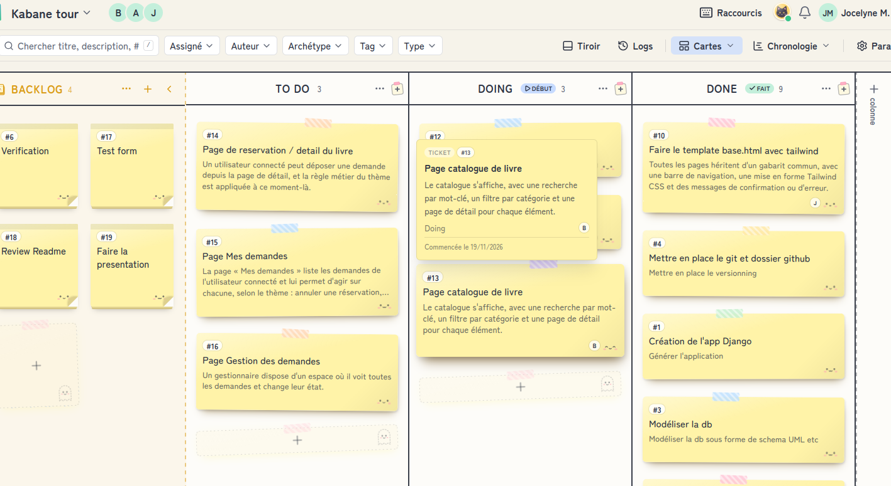

# ReadMe Library

Welcome to ReadMe Library, your warm and connected neighborhood library. Come borrow books, study or work in a quiet space, and enjoy cultural moments right around the corner.

## Contributors
+ Alex Vandenabeele
+ Benoît Michaux
+ Jocelyne Minard

## Installation
```pip install -r requirements.txt```

 After this please ask coworker for have data or organisation member:
 Put data folder inside project folder library  
 Create your .env file, we recommend setting DEBUG=False 
 ```
 cd library
 python manage.py migrate
 python manage.py add_data
 python manage.py collectstatic
 python manage.py runserver
 ```

 ## Mandatory Urls
 + [Home](http://127.0.0.1:8000/readme/)
 + [Catalog](http://127.0.0.1:8000/readme/catalog/)
 + [Book details](http://127.0.0.1:8000/readme/catalogue/274/?cover=ReadMe/img/covers/cover-11.jpg)
 + [Login](http://127.0.0.1:8000/account/login/)
 + [Logout](http://127.0.0.1:8000/account/logout/) only accessible via POST request, not directly via URL
 + [Profile](http://127.0.0.1:8000/account/profile/) only for logged-in users
 + [Edit profile](http://127.0.0.1:8000/account/edit/) only for logged-in users
 + [Registration](http://127.0.0.1:8000/account/register/)
 + [Reservation](http://127.0.0.1:8000/readme/reservation/) only for logged-in users
 + [Manage reservation](http://127.0.0.1:8000/readme/manage/reservations/) only for staff
 + [Manage early edition](http://127.0.0.1:8000/readme/manage/early-edition) only for staff

## Technical Choices
### DB Constraints
We changed one constraint because the date given in the brief blocks new reservations  
"Date de la demande, entre le 2026-09-01 et le 2026-11-15"
If we keep this, all new reservations are blocked, so we set the limit to December 31st, 2027

### dbdiagram
We selected **[dbdiagram.io](https://dbdiagram.io/home)** for database modeling due to its simplicity, zero-install browser interface, and free tier. Using plain-text DBML syntax makes it natively Git-compatible for easy version control, while built-in AI features remain optionally available if needed.

### SQLite
The use of SQLite is directly mandated by the project brief.

### Task management 
https://kabane.spendbaker.com/boards/kabane-tour-3989bb0d/wide



### Structure
Django automatically registers any Python script inside an app's management/commands/ directory as long as it doesn't start with an underscore. **[Django documentation**](https://docs.djangoproject.com/en/6.1/howto/custom-management-commands/)**

```
Brief_Django/
├── _.env_example                    # Example .env 
├── requirements.txt                 # File for python install
├── Readme.md                        # Readme file
└── docs/                            # Folder of project documentation
└── library/
    ├── .env                         # env file for configuration
    ├── manage.py                    # Manage file of Django project
    ├── Procfile.tailwind/           # File for Tailwing Django
    ├── database.md                  # Place for database creation
    └── Account/
        ├── management/              # Folder for create command
        ├── migrations/              # Folder for DB migrations
        ├── static/                  # Static files, CSS, JS and IMG 
        ├── templates/               # HTML templates
        └── files for app...         # 
    └── library/                     # Base App with settings
    └── ReadMe/                      # ReadMe App
        ├── management/              # Folder for create command
        ├── migrations/              # Folder for DB migrations
        ├── static/                  # Static files, CSS, JS and IMG 
        ├── templates/               # HTML templates
        ├── views/                   # Folder for all views
        └── files for app...         # 
    └── ReadmeStyle/                 # Tailwind folder
    ├── static/                      # Statics files, CSS, JS and IMG 
    ├── templates/                   # HTML base templates
    └── staticfiles/                 # Place where folder is create with command collectstatic
```


### Authentication
 To log in by email, we used an additional Django plugin: django-username-email 


### Interface
All illustrations inside the pages are generated by AI.  
Icons were downloaded from a free SVG library.   
For lang we change settings variables LANGUAGE_CODE and TIME_ZONE.  

## Bonus Features
+ Olivier Lacomblez requested a filter on reservation page
+ We make book availability and quantity 
+ Management page for feature Early Edition
+ Cross-sell Early edition on index, reservation and book details
+ Profil page
+ Catalog pagination
+ UI bonus for summaries of book on catalog page
+ Automatic random allocation cover for book 
+ Custom 403, 404, and 500 error pages