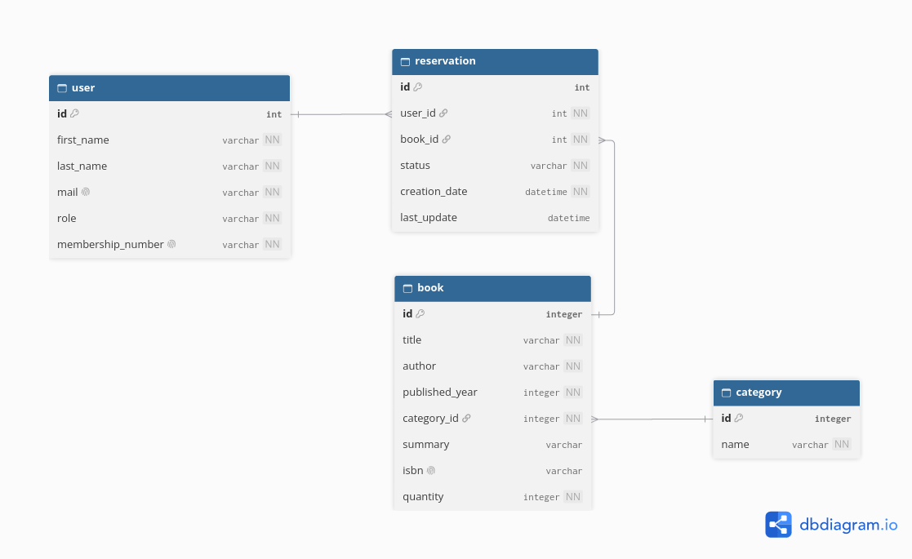

# ReadMe Library

Welcome to ReadMe Library, your warm and connected neighborhood library. Come borrow books, study or work in a quiet space, and enjoy cultural moments right around the corner.

## Contributeurs
+ Alex Vandenabeele
+ Benoît Michaux
+ Jocelyne Minard

## Installation
```pip install -r requierements.txt```

 After this please ask coworker for have data or organisation member:
 Put data folder inside project folder library  
 Create your .env file, preconise DEBUG FALSE
 ```
 cd library
 python manage.py migrate
 python manage.py add_data
 python manage.py collectstatic
 python manage.py runserver
 ```

 ## Mandatory Urls
 + [Home](http://127.0.0.1:8000/readme/)
 + [Catalog](http://127.0.0.1:8000/readme/catalog/)
 + [Book details](http://127.0.0.1:8000/readme/catalogue/274/?cover=ReadMe/img/covers/cover-11.jpg)
 + [Connection](http://127.0.0.1:8000/account/login/)
 + [Disconnect](http://127.0.0.1:8000/account/logout/) but this url is not accessible 
 + [Profil](http://127.0.0.1:8000/account/profil/) only for connect user
 + [Edit profil](http://127.0.0.1:8000/account/edit/) only for connect user
 + [Registration](http://127.0.0.1:8000/account/register/)
 + [Reservation](http://127.0.0.1:8000/readme/reservation/) only for connect user
 + [Manage reservation](http://127.0.0.1:8000/readme/manage/reservations/) only for staff
 + [Manage early edition](http://127.0.0.1:8000/readme/manage/early-edition) only for staff

## Technical choices
### dbdiagram
We selected **[dbdiagram.io](https://dbdiagram.io/home)** for database modeling due to its simplicity, zero-install browser interface, and free tier. Using plain-text DBML syntax makes it natively Git-compatible for easy version control, while built-in AI features remain optionally available if needed.

### SQLite
The use of SQLite is directly mandated by the project brief.

### Task management 
https://kabane.spendbaker.com/boards/kabane-tour-3989bb0d/wide


### Structure
Django automatically registers any Python script inside an app's management/commands/ directory as long as it doesn't start with an underscore. **[Django documentation**](https://docs.djangoproject.com/en/6.1/howto/custom-management-commands/)**

```
Brief_Django/
├── _.env_example                    # Example .env 
├── requirements.txt                 # File for python install
├── Readme.md                        # Readme file
└── docs/                            # Folder of project documentation
└── library/
    ├── .env                         # env file for configuration
    ├── manage.py                    # Manage file of Django project
    ├── Procfile.tailwind/           # File for Tailwing Django
    ├── database.md                  # Place for database creation
    └── Account/
        ├── management/              # 
        ├── mmigrations/             # 
        ├── static/                  # 
        ├── templates/               # 
        └── files for app...         # 
    └── library/
    └── ReadMe/
        ├── management/              # 
        ├── mmigrations/             # 
        ├── static/                  # 
        ├── templates/               # 
        ├── views/                   # 
        └── files for app...         # 
    └── ReadmeStyle/
    ├── static/
    ├── templates/
    └── staticfiles/                # Place where folder is create with command collectstatics
└── docs/
```



### Authentification
For connect by email we need to use another pluging of Django : django-username-email 


### Interface
The logo , all illustration inside pages is generate by AI.  
Icon is download on free svg library.  
For lang we change settings variables LANGUAGE_CODE and TIME_ZONE.  

## Features bonus
+ Olivier Lacomblez want filter on reservations page
+ We make disponibility and quantity of book
+ Management page for feature Early Edition
+ Cross-sell Early edition on index, reservation and book details
+ Profil page
+ Catalog pagination
+ UI bonus for sumary of book on catalog page
+ Automatic random allocation cover for book 
+ Page 403, 404 and 500